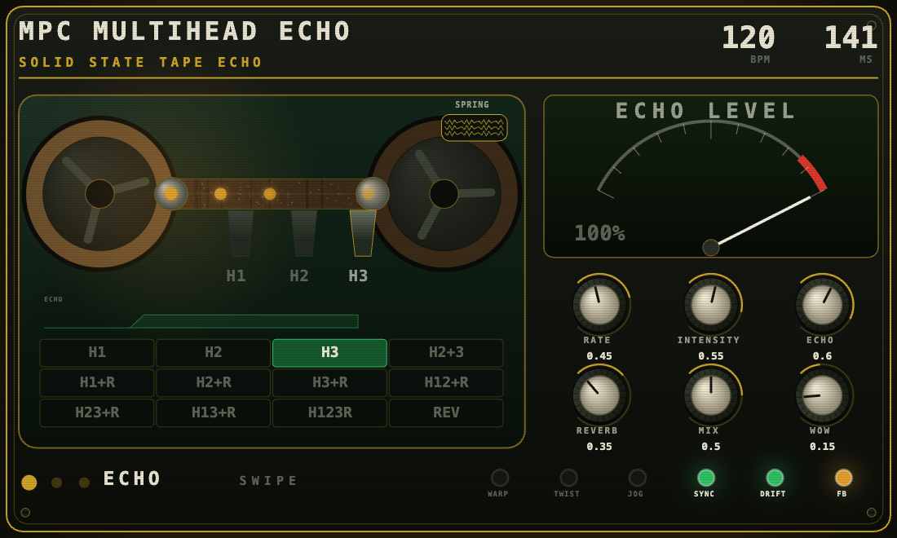

# MPC Multihead Echo

A three-head tape echo as a **native VST2 effect for MPC OS** (Akai MPC Live / One / X / Key, Force):
multi-head modes, three preamp characters, chorus, tape wear (drift, dropouts, hiss), stereo spread, a
joggable playhead, tempo sync with drift, a spring reverb — and a **companion screen** in the browser.

Inspired by the AIR Music Tech Tape Echo in the way it works; **not** a port and not affiliated with
AIR, inMusic or Akai. See `THIRD_PARTY_NOTICES.md`.



## Verified on the device

MPC Live II, MPC OS 3.9.1.2 (AZ0x 5.0.17), 2026-11-01:

- the plugin loads, plays and saves with a project; three interfaces were reduced to one (Roots)
- 32 parameters, 9 factory presets in the PRESET menu
- the companion screen answers on `http://<mpc-ip>:8099/` and controls the effect from a phone
  (swiping between three pages, dragging knobs, hold switches, tapping modes) — checked on Android

**Not verified / open:** no CPU bench has been run on the final build (the earlier measurement was
p99 24.4 % on the whole chain); nothing has been tested on a Force; the page is read/write on the LAN
without authentication — use `MHEC_HTTP_RW=0` if you do not want that.

## Build

```bash
git clone https://github.com/sd88me/mpc-vst-plugins
export MPC_VST_PLUGINS=$PWD/mpc-vst-plugins
./build.sh            # armhf .so + params + skin, needs Docker (with QEMU for arm32v7)
./test.sh             # offline: ASan host test, UI switch, options, DSP suites, page logic
```

`test.sh` needs `node` for the page logic check (it skips loudly without it).

## Install on the device

```bash
DEVICE=<mpc-ip> ./make_skinset.sh --deploy     # writes /sdcard/Synths/… and the effect presets
```

Then insert it: FX slot `+` → MANUFACTURER → **MPC Multihead Echo**. The skin swaps without an MPC
restart; a new `.so` needs one.

## Companion screen

The plugin starts its own HTTP server (port 8099, `MHEC_HTTP_PORT` overrides):

| path | what |
|---|---|
| `/` | the panel: ECHO, TAPE and SETUP pages, swipe between them |
| `/state` | the live numbers as JSON |
| `/diag` | the last eight requests with peer address and user agent |
| `POST /set?k=<param>&v=<value>` | the write path (requires the header `X-MHE: 1`) |

Set `MHEC_HTTP=0` in the plugin's environment to turn the listener off entirely.

The page's source is `web/index.html`; `web/embed.py` generates the C++ string and
`web/pagetest.mjs` runs the page headless under node (controls register, geometry, swipe, writes).

## Credits

**The companion screen is VADER's idea.** [VADER](https://github.com/sunskiefer/VADER) by
**sunskiefer (L'Cronx)** has served its screen as a web page from the plugin since **v0.6.0
(2026-10-24)**, for exactly the reason this port ran into: MPC draws a plugin's screen itself, a
plugin cannot draw on the device's display, and every moving widget costs MPC a redraw (a busy one
crackled the audio). His README states that plainly, and it is why the screen moved to the phone.

What is borrowed is the **approach**, not code: one canvas, motion extrapolated in the page between
updates, fullscreen, "add to home screen", and controls that get out of the way. The page here was
written from scratch against our own status feed, and the transport differs — VADER streams binary
frames over a WebSocket and answers mDNS as `vader.local`; this panel polls a small JSON document
about seven times a second and integrates the motion client-side. VADER is MIT-licensed; see
`THIRD_PARTY_NOTICES.md`.

Also: [sd88me/mpc-vst-plugins](https://github.com/sd88me/mpc-vst-plugins) (MIT) is the framework this
plugin is built and packaged with, and the engine in `src/ported/` is Dusk Audio's Tape Echo 2
(GPL-3.0) via `schwung-tape-echo2`.

## Layout of this repository

```
src/            the DSP stages, the module shell, the companion server, the vendored engine (ported/)
web/            index.html, 404.html, embed.py, pagetest.mjs
tests/          offline suites: companion, options, ui switch, dlclose lifetime, page logic
art/            faceplate generators and the PNGs they produce
docs/           RE-202 feature map, panel previews
```

## Licence

GPL-3.0-only, following the engine in `src/ported/`. If you ship a binary, ship the source.
